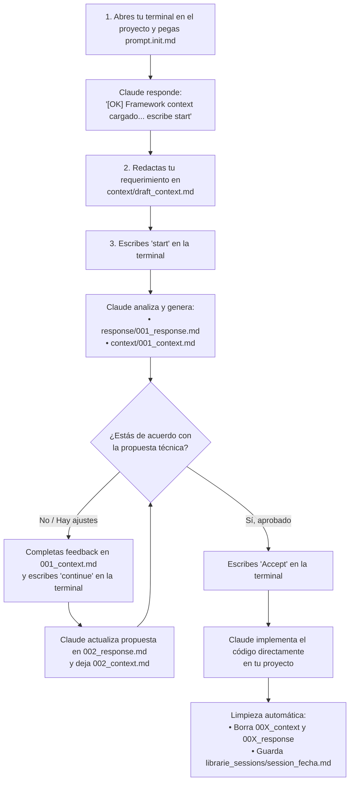

# Guía del Framework Context Claude

Esta guía explica en lenguaje claro cómo funciona este framework, por qué se diseñó de esta manera y el paso a paso exacto para usarlo en tu día a día sin desperdiciar tokens ni perder el hilo de tus desarrollos.

---

## 1. ¿Cómo se concibe este framework?

Este framework es tu **centro de operaciones de contexto independiente**. 

- Tú tienes tu terminal abierta en tu proyecto de trabajo real (donde programas día a día).
- Este framework vive en su propia carpeta en tu máquina (donde lo clones).
- Cuando abres Claude CLI en tu proyecto, le pegas el iniciador ([`prompt.init.md`](file:///C:/Project/context.claude/prompt.init.md)) diciéndole:  
  *"Gestiona todo el contexto, borradores y análisis en la ruta donde clonaste este framework, pero programa aquí en el proyecto donde tengo abierta la terminal"*.

---

## 2. Mapa del Framework de Contexto

```text
context.claude/
├── prompt.init.md          # Lo que copias y pegas en el CLI de tu proyecto
├── architecture.md         # Reglas internas que Claude lee al arrancar (el motor)
├── DOC.MD                  # Esta guía de uso para desarrolladores
├── .gitignore              # Evita subir archivos temporales a Git
│
├── context/                # Tu espacio de trabajo para requerimientos
│   ├── draft_context.md    # Aquí describes tu requerimiento inicial
│   └── 00X_context.md      # Archivos temporales donde contestas dudas de Claude
│
├── response/               # El espacio de propuestas de Claude
│   └── 00X_response.md     # Propuestas técnicas acumuladas generadas por Claude
│
└── librarie_sessions/      # La memoria permanente
    └── session_*.md        # Resúmenes limpios de lo que ya se programó
```

---

## 3. Diagrama del Flujo de Trabajo



---

## 4. Paso a Paso: Cómo usarlo en un desarrollo real

### Paso 0: Configuración inicial (Solo una vez al clonar el repositorio)
Apenas clones este framework en tu máquina:
1. Abre [`prompt.init.md`](file:///C:/Project/context.claude/prompt.init.md).
2. En la línea:
   ```markdown
   - **Ruta de Contexto:** `[PEGA_AQUÍ_LA_RUTA_ABSOLUTA_DONDE_CLONASTE_ESTE_FRAMEWORK]`
   ```
   Reemplaza el texto entre corchetes por la ruta absoluta de tu máquina donde quedó clonada esta carpeta (por ejemplo: `C:/Project/context.claude` o `/home/usuario/context.claude`).
3. Guarda el archivo. ¡Listo! Ya no tendrás que volver a cambiarlo, ahora tu plantilla siempre tendrá tu ruta local lista para copiar y pegar.

### Paso 1: Conectar a Claude desde tu proyecto
1. Abre la terminal en la carpeta de tu aplicación real (donde normalmente programas y ejecutas Claude CLI).
2. Abre [`prompt.init.md`](file:///C:/Project/context.claude/prompt.init.md), copia todo su contenido y pégalo en la terminal de Claude.
3. Claude leerá el protocolo y te contestará:
   ```text
   [OK] Framework context cargado exitosamente. Llena context/draft_context.md y escribe 'start' para comenzar.
   ```

### Paso 2: Redactar el requerimiento
Abre [`context/draft_context.md`](file:///C:/Project/context.claude/context/draft_context.md) en tu editor con calma:
- **Objetivo:** Qué quieres construir o resolver.
- **Alcance:** Qué pantallas, componentes, rutas o APIs tocaremos.
- **Criterios de Aceptación:** Casos exactos que deben funcionar sí o sí.
- **Restricciones:** Librerías o particularidades técnicas.
- Guarda el archivo.

### Paso 3: Arrancar el análisis con `start`
En la terminal de Claude escribe:
```text
start
```
Claude examina tu proyecto actual, va a la carpeta de contexto y crea:
- `response/001_response.md`: Su análisis del código existente, los archivos que piensa modificar, la arquitectura propuesta y dudas pendientes.
- `context/001_context.md`: Una plantilla en blanco lista para que tú le des feedback.

En tu terminal solo verás una línea:
```text
[OK] 001_response.md generado. Completa context/001_context.md y escribe 'continue' o 'Accept'.
```

### Paso 4: Revisar y ajustar (El ciclo `continue`)
Abre `response/001_response.md`:
- Si hay algo que corregir o dudas que responder, abre `context/001_context.md` y anota tus observaciones.
- Guarda el archivo y en la terminal escribe:
  ```text
  continue
  ```
- Claude generará `response/002_response.md` con los cambios integrados. Repites el proceso hasta que la solución técnica sea exactamente lo que buscas.

### Paso 5: Aprobar e implementar (`Accept`)
Cuando la propuesta técnica esté lista:
```text
Accept
```
1. Claude empieza a escribir código directamente en tu proyecto.
2. Al terminar y verificar que todo funcione, ejecuta la **limpieza automática**:
   - Borra todos los temporales `00X_context.md` y `00X_response.md`.
   - Limpia `draft_context.md` dejándolo en blanco para la siguiente tarea.
   - Guarda el resumen permanente en `librarie_sessions/session_DD_MM_YYYY.md`.
3. En la terminal finaliza con:
   ```text
   [DONE] Desarrollo finalizado. Resumen guardado en librarie_sessions/session_DD_MM_YYYY.md. Entorno limpio.
   ```

---

## 5. Tabla Rápida de Comandos para el CLI

| Lo que escribes en la terminal | Qué significa / Qué hace Claude |
| :--- | :--- |
| *(Pegar `prompt.init.md`)* | Conecta a Claude con la carpeta del framework, silencia el chat y se queda a la espera. |
| `start` (o `continue`) | Le indica a Claude que ya terminaste de redactar `draft_context.md` para que inicie el análisis técnico. |
| `continue` | Lee tu último feedback en `context/00X_context.md` y genera una propuesta corregida. |
| `Accept` | Aprueba la última propuesta técnica, programa en tu proyecto y limpia los temporales al terminar. |
